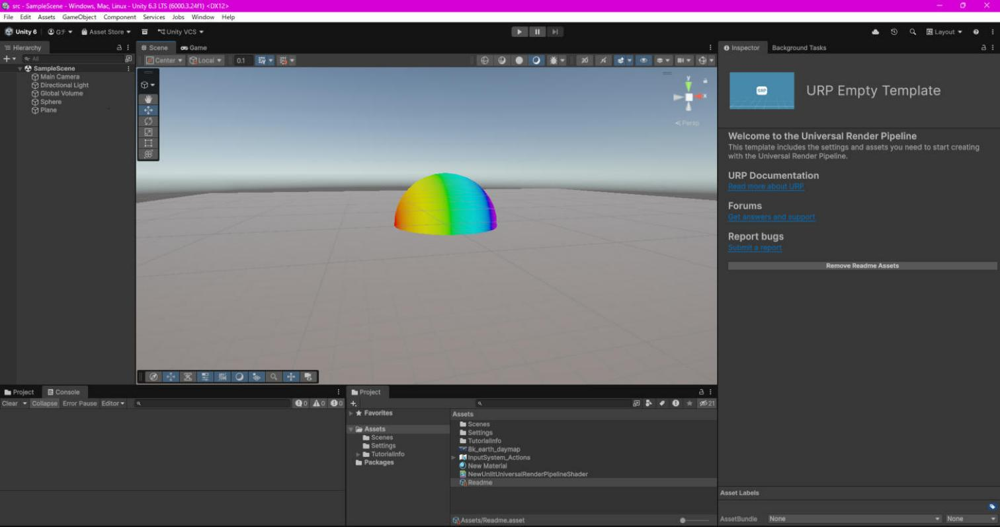

# はじめに
プログラムワークショップⅣの第2回の管理用です

# 結果画像

- 工夫した点：ワールド空間の法線のx成分を0〜1に変換し、赤→黄→緑→水色→青→紫の6色を `lerp` で補間して、球に虹色のグラデーションを付けました。

# 進め方

- 本リポジトリをforkしてください。
- fork先のリポジトリを更新してください
- Unityのプロジェクトをsrc内で進めて下さい。
- 結果を画面キャプチャして、画像としてリポジトリに追加して、上記のリンクから見れるようにしてください。
- 完成したら本リポジトリのmainブランチにpull requestを投げてください

